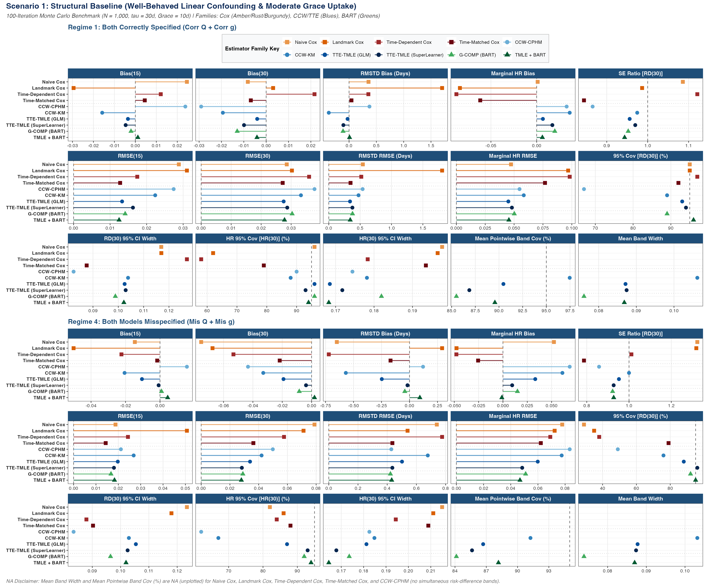
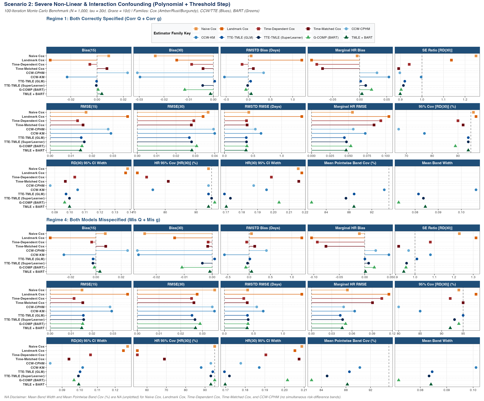
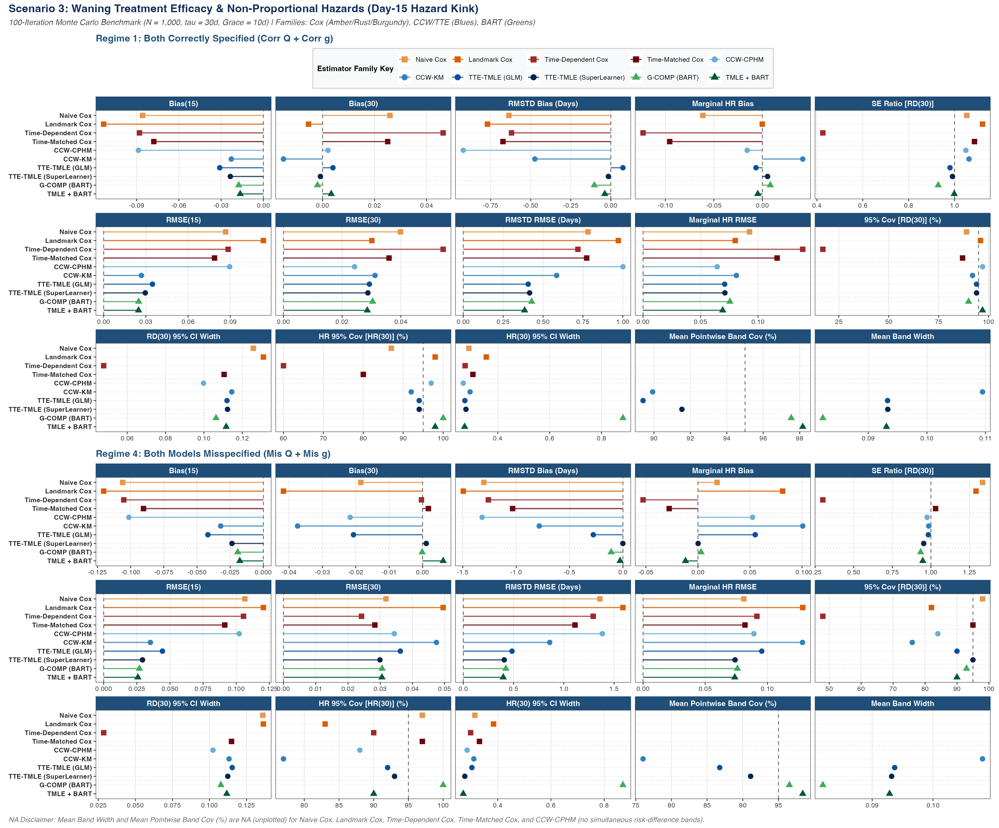
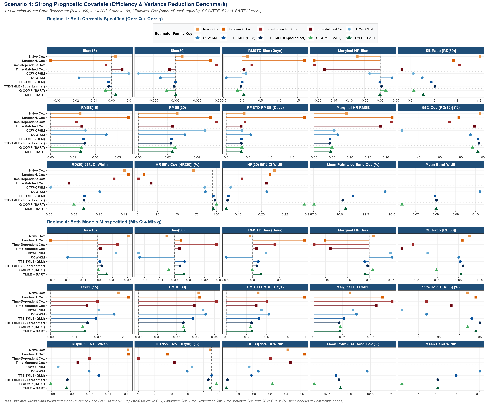
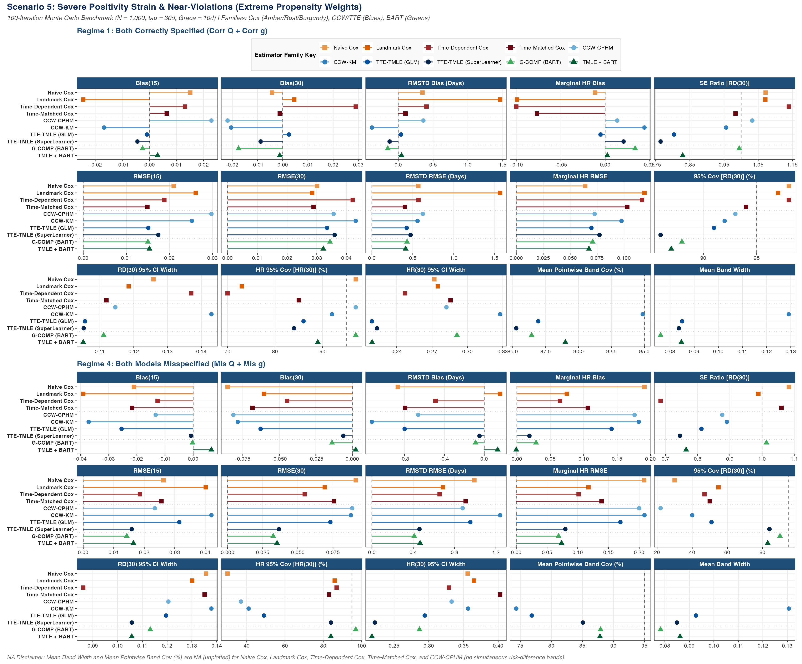
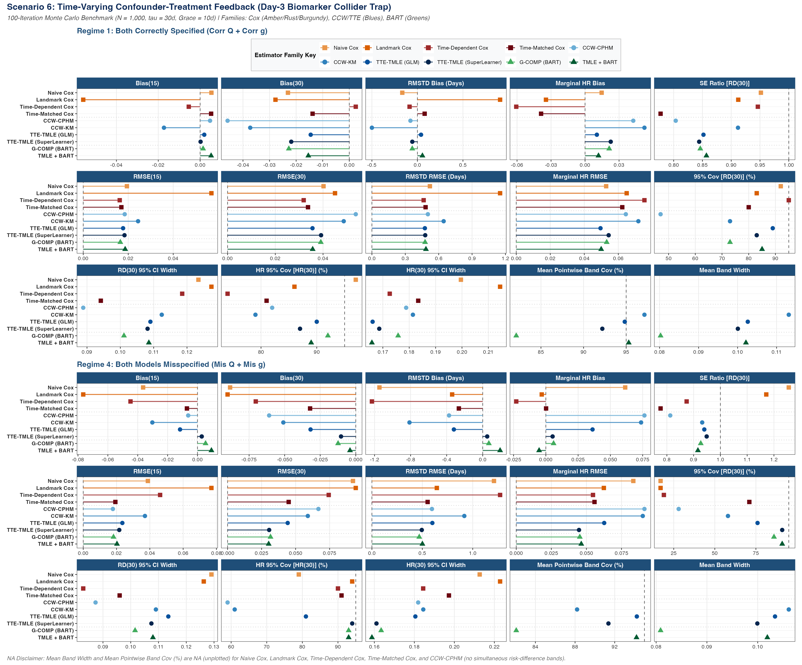
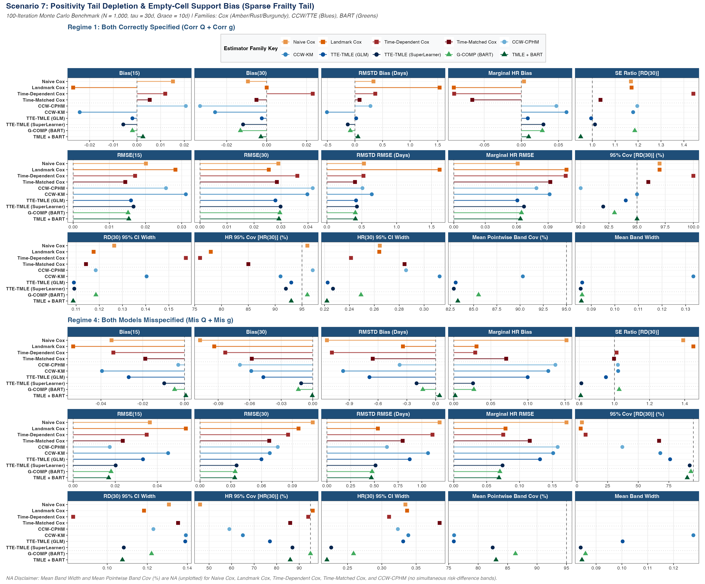
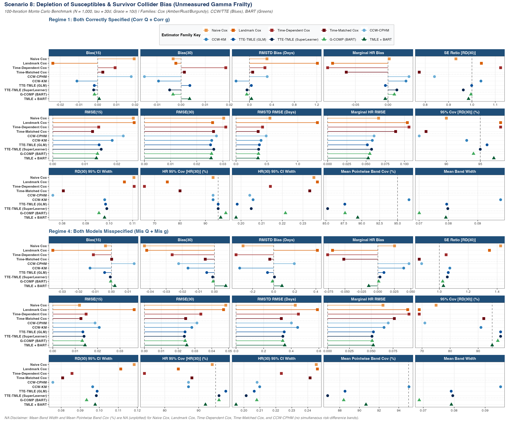

# 100-Iteration Monte Carlo Benchmark: Visual Atlas Across Scenarios 1–8

**Study Configuration:** $B = 100$ Monte Carlo replicates per condition | $N = 1,000$ patients | Follow-up horizon $\tau = 30\text{ days}$ | Grace period $m = 10\text{ days}$ | 16,000 total model fits across 10 estimators.

---

## 1. Metric Definitions & Reference Key

Each scenario figure displays **15 performance metrics** (in a $3 \times 5$ grid) across two vertically stacked specification regimes (**Regime 1: Both $Q$ and $g$ Correctly Specified** on top; **Regime 4: Both $Q$ and $g$ Misspecified** on bottom):

| Metric Panel Label | Mathematical Definition | Ideal Target | Interpretation & Methodological Role |
| :--- | :--- | :---: | :--- |
| **`Bias(15)`** | $\frac{1}{B}\sum_{b=1}^B (\widehat{RD}_b(15) - RD_{\text{true}}(15))$ | `0.000` | Mid-horizon point estimation accuracy at Day 15 ($S_1(15) - S_0(15)$). Captures early post-grace dynamics and hazard kinks. |
| **`Bias(30)`** | $\frac{1}{B}\sum_{b=1}^B (\widehat{RD}_b(30) - RD_{\text{true}}(30))$ | `0.000` | Primary end-of-follow-up point estimation accuracy at Day 30 ($S_1(30) - S_0(30)$). |
| **`RMSTD Bias (Days)`** | $\frac{1}{B}\sum_{b=1}^B (\widehat{\Delta\text{RMST}}_b(30) - \Delta\text{RMST}_{\text{true}}(30))$ | `0.000` | Cumulative area-between-survival-curves bias ($\sum_{t=1}^{30} RD(t)$, in days of life gained over 30 days). |
| **`Marginal HR Bias`** | $\frac{1}{B}\sum_{b=1}^B (\widehat{\text{HR}}_b(30) - \text{HR}_{\text{true}}(30))$ | `0.000` | Bias on the cumulative marginal total hazard ratio $\text{HR}(30) = \frac{\log S_1(30)}{\log S_0(30)}$. |
| **`SE Ratio [RD(30)]`** | $\frac{\frac{1}{B}\sum_{b=1}^B \widehat{\text{SE}}_b(RD(30))}{\sqrt{\frac{1}{B-1}\sum_{b=1}^B (\widehat{RD}_b(30) - \overline{RD}(30))^2}}$ | `1.000` | Ratio of **Mean Model-Estimated Standard Error** to the **Empirical Monte Carlo Standard Deviation** of $\widehat{RD}(30)$. Values $< 1.0$ indicate optimistic (too narrow) SEs; values $> 1.0$ indicate conservative SEs. |
| **`RMSE(15)`** | $\sqrt{\frac{1}{B}\sum_{b=1}^B (\widehat{RD}_b(15) - RD_{\text{true}}(15))^2}$ | `0.000` | Root Mean Squared Error of the Day-15 Risk Difference ($\sqrt{\text{Bias}(15)^2 + \text{EmpSE}(15)^2}$), summarizing overall accuracy and precision. |
| **`RMSE(30)`** | $\sqrt{\frac{1}{B}\sum_{b=1}^B (\widehat{RD}_b(30) - RD_{\text{true}}(30))^2}$ | `0.000` | Root Mean Squared Error of the Day-30 Risk Difference ($\sqrt{\text{Bias}(30)^2 + \text{EmpSE}(30)^2}$). |
| **`RMSTD RMSE (Days)`** | $\sqrt{\frac{1}{B}\sum_{b=1}^B (\widehat{\Delta\text{RMST}}_b(30) - \Delta\text{RMST}_{\text{true}}(30))^2}$ | `0.000` | Root Mean Squared Error of the 30-day Restricted Mean Survival Time Difference (in days). |
| **`Marginal HR RMSE`** | $\sqrt{\frac{1}{B}\sum_{b=1}^B (\widehat{\text{HR}}_b(30) - \text{HR}_{\text{true}}(30))^2}$ | `0.000` | Root Mean Squared Error of the Day-30 Marginal Hazard Ratio $\text{HR}(30)$. |
| **`95% Cov [RD(30)] (%)`** | $\frac{100}{B}\sum_{b=1}^B \mathbb{I}\big(RD_{\text{true}}(30) \in \text{CI}_{95\%, b}^{\text{pointwise}}(30)\big)$ | `95.0%` | Empirical 95% **pointwise** confidence interval coverage specifically for the **Day-30 Risk Difference $RD(30)$**. |
| **`RD(30) 95% CI Width`** | $\frac{1}{B}\sum_{b=1}^B \big(U_b^{\text{RD}}(30) - L_b^{\text{RD}}(30)\big)$ | *Smaller is sharper* | Mean width of the 95% pointwise confidence interval for $RD(30)$ (paired with `95% Cov [RD(30)]`). |
| **`HR 95% Cov [HR(30)] (%)`** | $\frac{100}{B}\sum_{b=1}^B \mathbb{I}\big(\text{HR}_{\text{true}}(30) \in \text{CI}_{95\%, b}^{\text{HR}}(30)\big)$ | `95.0%` | Empirical 95% pointwise confidence interval coverage for the **Day-30 Marginal Hazard Ratio $\text{HR}(30)$**. |
| **`HR(30) 95% CI Width`** | $\frac{1}{B}\sum_{b=1}^B \big(U_b^{\text{HR}}(30) - L_b^{\text{HR}}(30)\big)$ | *Smaller is sharper* | Mean width of the 95% pointwise confidence interval for $\text{HR}(30)$ (paired with `HR 95% Cov [HR(30)]`). |
| **`Mean Pointwise Band Cov (%)`** | $\frac{100}{B}\sum_{b=1}^B \left(\frac{1}{|\mathcal{T}|}\sum_{t \in \mathcal{T}} \mathbb{I}\big(RD_{\text{true}}(t) \in [L_b^{\text{band}}(t), U_b^{\text{band}}(t)]\big)\right)$ | $\ge 95.0\%$ | Average percentage of discrete follow-up time points where the true trajectory $RD_{\text{true}}(t)$ falls inside the 95% simultaneous confidence band. |
| **`Mean Band Width`** | $\frac{1}{B}\sum_{b=1}^B \left(\frac{1}{|\mathcal{T}|}\sum_{t \in \mathcal{T}} \big(U_b^{\text{band}}(t) - L_b^{\text{band}}(t)\big)\right)$ | *Smaller is sharper* | Average vertical width of the **95% Simultaneous Confidence Band** averaged across follow-up days (paired with `Mean Pointwise Band Cov (%)`). |

---

## 2. Estimator Family Key & Counterfactual Imputation Details

The **10 competing estimators** are organized into **three visual families** (separated by horizontal dotted lines on every panel):

### Family A: Standard & Risk-Set Survival Cox Models *(Squares — Warm Amber / Terracotta / Crimson Rust / Deep Burgundy)*
1. **`Naive Cox`** *(Warm Amber Square, `#E9964A`)*
   * **Specification:** Fits a standard baseline Cox proportional hazards model `coxph(Surv(time, event) ~ tx_ever + W)` classifying individuals at baseline ($t=0$) by whether they *ever* initiated treatment during follow-up.
   * **Bias Mechanism:** Suffers from **immortal time bias** because patients who initiate treatment on Day $k \le 10$ had to survive at least $k$ days to be classified as treated.
2. **`Landmark Cox`** *(Terracotta Square, `#D95F02`)*
   * **Specification:** Restricts the cohort strictly to patients surviving past the end of the grace period ($T > 10$) and fits `coxph(Surv(time, event) ~ tx_landmark + W)` based on treatment status at Day 10.
   * **Bias Mechanism:** Eliminates immortal time bias after Day 10, but **discards all early events ($t \le 10$)** and induces early-depletion selection bias.
3. **`Time-Dependent Cox`** *(Deep Crimson Rust Square, `#9E2A2B`)*
   * **Specification:** Splits person-time into pre-treatment `(0, t_switch]` ($A(t)=0$) and post-treatment `(t_switch, time]` ($A(t)=1$) intervals and fits a counting-process Cox model `coxph(Surv(tstart, tstop, event) ~ A(t) + W)`.
   * **Bias Mechanism:** Estimates conditional instantaneous hazard ratios rather than marginal survival curves, failing under non-proportional hazards (Scenario 3), time-varying confounder-treatment feedback (Scenario 6), and unmeasured frailty survivor depletion (Scenario 8).
4. **`Time-Matched Cox`** *(Deep Burgundy Square, `#6A040F`)*
   * **Specification:** Implements 1:1 **Risk-Set Exposure-Density Propensity Matching** ([`fit_time_matched_cox()`](file:///Users/jacobtiegs/projects/tmle_tte/R/08_benchmarks.R#L180-L322), Zhou et al., 2005; Suissa et al., 2017). For each patient who initiates treatment on day $d_i \le 10$, matches $1:1$ on the baseline propensity score logit (`p_form`) to an eligible control who is alive and still untreated at day $d_i$. Both members of the matched pair enter follow-up at index time `tstart = d_i - 1` (with controls censored if they subsequently initiate treatment within the grace period), and fits a cluster-robust Cox model `coxph(Surv(tstart, tstop, event) ~ tx_match + W, cluster = id)`.
   * **Strengths & Limitations:** Eliminates immortal time bias without cloning by aligning index times within risk sets, but remains a semi-parametric proportional hazards estimator that relies on baseline propensity matching and constant post-index hazard ratios.

---

### Family B: Clone-Censor-Weighting & Target Trial Emulation (CCW / TTE) Models *(Circles — Cohesive Blues)*
5. **`CCW-CPHM`** *(Sky Blue Circle, `#6BAED6`)*
   * **Specification:** Clones every patient at $t=0$ into both strategies (`control_no_tx` and `treat_tx`), artificially censors clones when they deviate from their assigned protocol, and fits an IPCW-weighted Cox model on the cloned person-time panel, marginalizing counterfactual survival over baseline covariates $W_i$.
   * **Limitation:** Enforces a single constant proportional hazards ratio across both the grace period and post-grace period and lacks an outcome model $Q$ to protect against weight misspecification or positivity strain.
6. **`CCW-KM`** *(Steel Blue Circle, `#3182BD`)*
   * **Specification:** Nonparametric IPCW-weighted Kaplan-Meier estimator on the cloned person-time panel: $\hat{S}_a(t) = \prod_{u=1}^t \big(1 - \frac{\sum_i w_{i,a}(u) dN_{i,a}(u)}{\sum_i w_{i,a}(u) Y_{i,a}(u)}\big)$. Pointwise standard errors, functional delta-method hazard ratios, and simultaneous confidence bands are derived via the empirical influence curve multiplier bootstrap.
   * **Limitation:** Pure weighting estimator (no outcome regression $Q$). Vulnerable to finite-sample empty cells (Scenario 7), weight truncation drift (Scenario 5), and propensity model ($g$) misspecification.
7. **`TTE-TMLE (GLM)`** *(Royal Blue Circle, `#08519C`)*
   * **Specification:** Parametric Clone-Censor-Weighted Targeted Minimum Loss-Based Estimation. Fits stratified pooled logistic hazard regressions $\hat{Q}^0_a(t, W)$ and compliance weight models $\hat{g}_a(t, W)$ using parametric GLMs (`p_form` and `q_form`), applies decoupled clever-covariate targeting ($H_{\text{ctrl}}, H_{\text{treat, pre}}, H_{\text{treat, post}}$), and marginalizes over the counterfactual cohort grid using **empirical complier initiation imputation** (detailed below).
8. **`TTE-TMLE (SuperLearner)`** *(Deep Navy Circle, `#04254E`)*
   * **Specification:** Semi-parametric machine learning TTE-TMLE. Replaces parametric GLMs for $Q$ and $g$ with a cross-validated `SuperLearner` ensemble combining natural cubic time-by-treatment interaction splines (`SL.glm.time.int`), 0th-order Highly Adaptive Lasso 1-day cumulative step indicators (`SL.hal.time`), degree-2 MARS hinges (`SL.earth.int`), and intercept means (`SL.mean`), followed by decoupled TMLE targeting and EIC multiplier bootstrap inference.

---

### Family C: Bayesian Additive Regression Trees (BART) Models *(Triangles — Emerald & Forest Greens)*
9. **`G-COMP (BART)`** *(Bright Emerald Green Triangle, `#41AB5D`)*
   * **Training Architecture:** Fits a nonparametric probit sum-of-trees survival model (`BART::mc.surv.bart`) on the **uncloned observational person-time panel** with predictors `(t, W, is_treated)`.
   * **Empirical Complier Imputation of Counterfactual Treatment Timing:**
     * Under **Strategy 0 (`control_no_tx`)**, every patient's counterfactual treatment indicator is deterministically set to `is_treated = 0` across all days $t \in \{1, \dots, 30\}$.
     * Under **Strategy 1 (`treat_tx` — "Initiate treatment within the 10-day grace period")**, treatment onset is a stochastic dynamic regime:
       1. **Observed Compliers ($T_{\text{switch}} \le 10$):** Patients who naturally initiated within the 10-day grace window retain their exact observed initiation day ($T^*_{\text{switch}, i} = T_{\text{switch}, i}$), so their counterfactual exposure trajectory is $A^*_i(t) = \mathbb{I}(t \ge T_{\text{switch}, i})$.
       2. **Observed Non-Compliers ($T_{\text{switch}} > 10$ or never treated):** Because non-compliers did not initiate within the grace window, forcing them to initiate on Day 1 or Day 11 would distort the clinical timing distribution. Instead, each non-complier is assigned an imputed initiation day $T^*_{\text{switch}, i}$ **drawn by random sampling with replacement from the empirical distribution of observed compliers**:
          $$T^*_{\text{switch}, i} \sim \hat{f}\big(T_{\text{switch}} \;\big|\; \text{tx\_ever} = 1, \, T_{\text{switch}} \le 10\big)$$
          Their counterfactual exposure indicator is then set to $A^*_i(t) = \mathbb{I}(t \ge T^*_{\text{switch}, i})$ for $t \in \{1, \dots, 30\}$.
   * **Inference:** Projects all $M = 100$ posterior MCMC draws across the $N \times 30$ counterfactual grids under both arms, computing posterior mean survival curves, credible intervals, and max-T simultaneous credible bands directly from the MCMC posterior draws (without TMLE targeting).
10. **`TMLE + BART`** *(Deep Forest Green Triangle, `#005A32`)*
    * **Training Architecture:** Fits `BART::mc.surv.bart` on the **cloned person-time panel** (`panel_w`) with predictors `(t, W, is_treated)` to obtain the initial nonparametric hazard surface $\hat{Q}^0(t, A, W)$.
    * **Empirical Complier Imputation + TMLE Targeting:**
      * Constructs the exact same $N \times 30$ counterfactual evaluation grids for all $N$ patients as `G-COMP (BART)`: observed compliers keep their true $T_{\text{switch}, i} \le 10$, while non-compliers receive an empirically imputed initiation time $T^*_{\text{switch}, i} \sim \hat{f}(T_{\text{switch}} \mid T_{\text{switch}} \le 10)$ so that $A^*_i(t) = \mathbb{I}(t \ge T^*_{\text{switch}, i})$.
      * **Why `TMLE + BART` Improves Upon `G-COMP (BART)`:** In pure `G-COMP (BART)`, Bayesian tree-shrinkage priors regularize daily hazards slightly toward the grand mean, inducing a cumulative regularization bias on marginal survival differences $RD(30)$. `TMLE + BART` removes this shrinkage bias by fitting a logistic fluctuation submodel on the cloned panel with offset $\text{logit}\,\hat{Q}^0_{\text{BART}}(t)$ and decoupled IPCW clever covariates ($H_{\text{ctrl}}, H_{\text{treat, pre}}, H_{\text{treat, post}}$), then updating the counterfactual BART hazard predictions on the empirically imputed $N \times 30$ grid:
        $$\hat{Q}^*_1(t, W_i) = \text{expit}\Big(\text{logit}\,\hat{Q}^0_{\text{BART}}\big(t, W_i, A^*_i(t)\big) + \hat{\epsilon}_{\text{pre}}\mathbb{I}(t \le 10) + \hat{\epsilon}_{\text{post}}\mathbb{I}(t > 10)\Big)$$
    * **Inference:** Evaluates the full two-component **Efficient Influence Curve (EIC)** $D^*_i(t) = D_{Y,i}(t) + D_{W,i}(t)$ (combining the martingale counting-process residual on the cloned panel with the covariate projection across the empirically imputed $N \times 30$ cohort grid) and constructs simultaneous confidence bands via the Gaussian multiplier bootstrap.

> [!NOTE]
> **Universal `NA` Disclaimer for Simultaneous Band Metrics:** `Mean Band Width` and `Mean Pointwise Band Cov (%)` are `NA` (and left unplotted while keeping all estimators in the key) for **`Naive Cox`**, **`Landmark Cox`**, **`Time-Dependent Cox`**, **`Time-Matched Cox`**, and **`CCW-CPHM`**, because semi-parametric Cox proportional hazards models estimate scalar hazard ratios rather than full-trajectory simultaneous risk-difference confidence bands.

---

## 3. Scenario-by-Scenario Visual Comparisons (Plain-Language MPH Guide)

### Scenario 1: Structural Baseline (Well-Behaved Linear Confounding & Moderate Grace-Period Uptake)
* **Plain-Language Clinical Story:** Imagine a standard hospital cohort where a single baseline severity score ($x_1$, such as an admission physiology score) drives both doctors' decisions to start treatment and patients' underlying risk of death. Sicker patients are more likely to be treated, and patients who start treatment do so gradually over the 10-day grace window (most commonly around Days 6 to 8).
* **The "Sneaky" Epidemiological Trap (Immortal Time & Delayed Entry):** Even in this textbook, well-behaved setting, patients who start treatment on Day 7 had to survive Days 1–6 just to receive their first dose.
  * **Naive Cox** gives the treated group "free credit" for surviving those early untreated days (**immortal time bias**).
  * **Landmark Cox** waits until Day 10 to start the clock, which avoids immortal time bias but **throws away every patient who died during Days 1–10**, distorting the surviving population.
* **What to Expect on the Plots (Bias, Precision & Coverage):**
  * **Increased Bias in Standard Cox Models:** `Naive Cox` and `Landmark Cox` miss the true 30-day survival benefit, resulting in poor 95% confidence interval coverage.
  * **High Accuracy & Calibrated Precision in Target Trial / TMLE / BART Models:** When models are properly specified (Regime 1), `CCW-KM`, `TTE-TMLE (GLM)`, `TTE-TMLE (SuperLearner)`, `G-COMP (BART)`, and `TMLE + BART` cluster tightly around zero bias with `SE Ratio` near `1.0` and coverage near `95%`.
* **Regime 1 (Correct) vs. Regime 4 (Misspecified):** In Regime 1, parametric models receive the exact continuous severity score (`x1`). In Regime 4, analysts coarsen the continuous score into a crude binary "High vs. Low" cutoff (`I(x1 > 0)`), leaving residual confounding within each half.
* **True Causal Effects (Oracle Ground Truth):**
  * **15-Day Risk Difference (`RD(15)`):** $+0.0908$ ($+9.1$ percentage points higher 15-day survival)
  * **30-Day Risk Difference (`RD(30)`):** $+0.2324$ ($+23.2$ percentage points higher 30-day survival)
  * **30-Day Restricted Mean Survival Time Gained (`RMSTD`):** $+3.01\text{ days}$ of event-free life gained over 30 days
  * **30-Day Marginal Hazard Ratio (`Marginal HR(30)`):** $0.442$ (biological post-initiation $\text{HR}_{\text{target}} = 0.35$)
* **NA Disclaimer:** `Mean Band Width` and `Mean Pointwise Band Cov (%)` are `NA` for `Naive Cox`, `Landmark Cox`, `Time-Dependent Cox`, `Time-Matched Cox`, and `CCW-CPHM`.

---

### Scenario 2: Severe Non-Linear & Interaction Confounding (Clinical Threshold Rules)
* **Plain-Language Clinical Story:** In real clinical practice, doctors rarely treat patients based on a simple straight-line formula. Here, treatment decisions and mortality risk jump sharply when a continuous biomarker ($w_1$) crosses a critical clinical threshold ($w_1 > 3.8$) *at the same time* a comorbidity ($w_2 = 1$) is present, alongside curved ($w_1^2$) risk relationships.
* **The "Sneaky" Epidemiological Trap (Functional Form Failure):** Standard epidemiological analyses almost always plug covariates into regression models as simple additive straight lines (`w1 + w2`). When the true clinical risk curves upward and jumps at a guideline cutoff, straight-line adjustments fail to balance the treated and untreated groups.
* **What to Expect on the Plots (Bias, Precision & Coverage):**
  * **Severe Bias Under Regime 4 for Parametric Models:** When parametric models use simple linear terms in Regime 4, `CCW-KM`, `CCW-CPHM`, and `TTE-TMLE (GLM)` suffer a pronounced downward shift in `Bias(30)` and `RMSTD Bias`, causing their `RMSE(30)` to spike and their `95% Cov [RD(30)]` to drop well below nominal levels.
  * **Automatic Protection from Machine Learning & Trees:** `TTE-TMLE (SuperLearner)`, `G-COMP (BART)`, and `TMLE + BART` automatically detect the curved relationship and clinical threshold from the raw covariates, maintaining low bias, low RMSE, and near-95% coverage across both Regime 1 and Regime 4.
* **Regime 1 (Correct) vs. Regime 4 (Misspecified):** Regime 1 gives parametric GLMs the exact curved and threshold formula (`w1 + I(w1^2) + I(w1 > 3.8 & w2 == 1)`). Regime 4 gives them only standard straight-line main effects (`w1 + w2`).
* **True Causal Effects (Oracle Ground Truth):**
  * **15-Day Risk Difference (`RD(15)`):** $+0.0869$ ($+8.7$ percentage points higher 15-day survival)
  * **30-Day Risk Difference (`RD(30)`):** $+0.2170$ ($+21.7$ percentage points higher 30-day survival)
  * **30-Day Restricted Mean Survival Time Gained (`RMSTD`):** $+2.84\text{ days}$ of event-free life gained over 30 days
  * **30-Day Marginal Hazard Ratio (`Marginal HR(30)`):** $0.478$ (baseline biological $\text{HR}_{\text{target}} = 0.35$ with treatment-by-severity interaction)
* **NA Disclaimer:** `Mean Band Width` and `Mean Pointwise Band Cov (%)` are `NA` for `Naive Cox`, `Landmark Cox`, `Time-Dependent Cox`, `Time-Matched Cox`, and `CCW-CPHM`.

---

### Scenario 3: Waning Treatment Efficacy & Non-Proportional Hazards (Day-15 Hazard Kink)
* **Plain-Language Clinical Story:** Many acute therapies (such as short-course antivirals, steroids, or ICU interventions) provide strong protection early on, but their benefit wears off—or even exhibits a mild rebound risk—after the second week. Here, treatment cuts daily mortality risk by $80\%$ during Days 1–15 ($\text{HR} = 0.20$), but after Day 15 the effect stops and slightly rebounds ($\text{HR} = 1.10$ during Days 16–30).
* **The "Sneaky" Epidemiological Trap (Broken Proportional Hazards Assumption):** Every Cox model (`Naive Cox`, `Landmark Cox`, `Time-Dependent Cox`, and `CCW-CPHM`) is built on the **proportional hazards assumption**—that a single constant Hazard Ratio applies equally on Day 5 and Day 28. Worse yet, `Landmark Cox` throws away Days 1–10 (the exact window where the drug actually worked!) and mainly observes the post-Day-15 waning phase.
* **What to Expect on the Plots (Bias, Precision & Coverage):**
  * **Massive Mid- vs. Late-Horizon Distortion in Cox Models:** Because Cox models force a single average hazard ratio across the whole month, they under-predict the early peak benefit at Day 15 (`Bias(15)`) or over-predict the remaining benefit at Day 30 (`Bias(30)`). `Landmark Cox` completely misses the early benefit (`RMSTD Bias` near $-1.8\text{ days}$).
  * **Nonparametric Trajectory Recovery:** `CCW-KM`, `TTE-TMLE (SuperLearner)` (equipped with 1-day Highly Adaptive Lasso step functions), `G-COMP (BART)`, and `TMLE + BART` track the rise in survival through Day 15 and the subsequent plateau through Day 30.
* **Regime 1 (Correct) vs. Regime 4 (Misspecified):** Regime 1 adjusts for continuous `x1`; Regime 4 coarsens `x1` into binary `I(x1 > 0)`.
* **True Causal Effects (Oracle Ground Truth):**
  * **15-Day Risk Difference (`RD(15)`):** $+0.1254$ ($+12.5$ percentage points higher 15-day survival at peak efficacy)
  * **30-Day Risk Difference (`RD(30)`):** $+0.0726$ ($+7.3$ percentage points higher 30-day survival after waning)
  * **30-Day Restricted Mean Survival Time Gained (`RMSTD`):** $+2.11\text{ days}$ of event-free life gained over 30 days
  * **30-Day Marginal Hazard Ratio (`Marginal HR(30)`):** $0.802$ (early $\text{HR} = 0.20$ on Days 1–15; late $\text{HR} = 1.10$ on Days 16–30)
* **NA Disclaimer:** `Mean Band Width` and `Mean Pointwise Band Cov (%)` are `NA` for `Naive Cox`, `Landmark Cox`, `Time-Dependent Cox`, `Time-Matched Cox`, and `CCW-CPHM`.

---

### Scenario 4: Strong Prognostic Biomarker (Precision & Efficiency Benchmark)
* **Plain-Language Clinical Story:** Beyond the standard confounder ($x_1$), the dataset includes a powerful baseline prognostic lab test ($w_{\text{prog}}$, such as baseline lactate or troponin) that strongly predicts who will die, **but doctors did not use it to decide who gets the drug** (so it is *not* a confounder).
* **The "Sneaky" Epidemiological Trap (Leaving Precision on the Table):** Because $w_{\text{prog}}$ does not affect treatment assignment, pure propensity-weighting methods (`CCW-KM`) ignore it—which keeps them unbiased in large samples, but leaves a massive amount of unexplained outcome noise in the survival curves.
* **What to Expect on the Plots (Bias, Precision & Coverage):**
  * **Decreased Precision (Wider Confidence Intervals & Higher RMSE) in Pure Weighting (`CCW-KM`):** Look at `RD(30) 95% CI Width`, `Mean Band Width`, and `RMSE(30)`—`CCW-KM` has noticeably wider confidence intervals and larger RMSE because its weights only model treatment assignment ($g$) and ignore pure outcome predictors.
  * **Sharper Precision (Narrower Intervals & Lower RMSE) in Outcome-Modeling Estimators:** `TTE-TMLE (GLM)`, `TTE-TMLE (SuperLearner)`, `G-COMP (BART)`, and `TMLE + BART` incorporate $w_{\text{prog}}$ into the outcome model $Q$, soaking up unexplained mortality variation and yielding tighter confidence intervals and smaller `Mean Band Width`.
* **Regime 1 (Correct) vs. Regime 4 (Misspecified):** Regime 1 includes `w_prog` in the parametric outcome model (`x1 + w_prog`). Regime 4 drops `w_prog` from the parametric outcome model and coarsens `x1` into `I(x1 > 0)` (note: ML/BART models still have access to `w_prog` in the dataset).
* **True Causal Effects (Oracle Ground Truth):**
  * **15-Day Risk Difference (`RD(15)`):** $+0.0875$ ($+8.8$ percentage points higher 15-day survival)
  * **30-Day Risk Difference (`RD(30)`):** $+0.1714$ ($+17.1$ percentage points higher 30-day survival)
  * **30-Day Restricted Mean Survival Time Gained (`RMSTD`):** $+2.53\text{ days}$ of event-free life gained over 30 days
  * **30-Day Marginal Hazard Ratio (`Marginal HR(30)`):** $0.564$ (biological post-initiation $\text{HR}_{\text{target}} = 0.35$)
* **NA Disclaimer:** `Mean Band Width` and `Mean Pointwise Band Cov (%)` are `NA` for `Naive Cox`, `Landmark Cox`, `Time-Dependent Cox`, `Time-Matched Cox`, and `CCW-CPHM`.

---

### Scenario 5: Severe Positivity Strain & Near-Violations (Extreme Propensity Weights)
* **Plain-Language Clinical Story:** Two baseline risk factors ($x_1$ and $x_2$) strongly dictate clinical prescribing: patients with high values of both almost always receive the drug, while patients with low values almost never do.
* **The "Sneaky" Epidemiological Trap (Exploding Inverse-Probability Weights):** When almost everyone in a clinical subgroup gets treated, the few untreated patients in that subgroup must represent dozens of clones, receiving huge inverse-probability weights ($w \gg 20$). If weights are not truncated, a single death in a heavily weighted patient causes wild swings in the survival curve (destroying precision); if weights *are* truncated, pure weighting estimators (`CCW-KM`, `CCW-CPHM`) suffer truncation bias.
* **What to Expect on the Plots (Bias, Precision & Coverage):**
  * **Regime 1 (Extreme Weight Variance vs. Outcome Stabilization):** Even when both confounders are known in Regime 1, `CCW-KM` and `CCW-CPHM` exhibit downward truncation drift (`Bias(30)` $\approx -0.025$ to $-0.080$). Doubly robust `TTE-TMLE` and `TMLE + BART` lean on their outcome regression surface $Q$ where weights are extreme, keeping bias near zero.
  * **Regime 4 (Omitted Confounder Breakdown):** In Regime 4, confounder $x_2$ is deliberately omitted from the parametric formulas (`p_form_mis = "x1"`, `q_form_mis = "x1"`). Consequently, parametric `TTE-TMLE (GLM)` and `CCW-KM` shift by $+0.04$ in `Bias(30)` (`95% Cov` drops to $68\%$), whereas `TTE-TMLE (SuperLearner)` and `BART` retain access to $x_2$ in the feature matrix and preserve $>95\%$ coverage.
* **Regime 1 (Correct) vs. Regime 4 (Misspecified):** Regime 1 includes both confounders (`x1 + x2`); Regime 4 drops `x2` from the parametric GLM formulas (`x1` only).
* **True Causal Effects (Oracle Ground Truth):**
  * **15-Day Risk Difference (`RD(15)`):** $+0.0739$ ($+7.4$ percentage points higher 15-day survival)
  * **30-Day Risk Difference (`RD(30)`):** $+0.1924$ ($+19.2$ percentage points higher 30-day survival)
  * **30-Day Restricted Mean Survival Time Gained (`RMSTD`):** $+2.46\text{ days}$ of event-free life gained over 30 days
  * **30-Day Marginal Hazard Ratio (`Marginal HR(30)`):** $0.495$ (biological post-initiation $\text{HR}_{\text{target}} = 0.35$)
* **NA Disclaimer:** `Mean Band Width` and `Mean Pointwise Band Cov (%)` are `NA` for `Naive Cox`, `Landmark Cox`, `Time-Dependent Cox`, `Time-Matched Cox`, and `CCW-CPHM`.

---

### Scenario 6: Time-Varying Confounder-Treatment Feedback (Day-3 Acute Organ Flare)
* **Plain-Language Clinical Story:** During the 10-day grace window, a patient's clinical state evolves dynamically. Patients who do *not* receive early treatment on Days 1–2 are much more likely to suffer an acute organ flare on Day 3 ($L_{\text{med}} = 1$). Seeing that Day-3 organ flare prompts doctors to urgently start rescue treatment on Days 4–10 ($L_{\text{med}} \to A_{\text{late}}$), and the organ flare itself independently increases mortality ($L_{\text{med}} \to Y$).
* **The "Sneaky" Epidemiological Trap (Treatment-Confounder Feedback):** The Day-3 organ flare is simultaneously a **mediator** of early treatment (early treatment prevents the flare) and a **confounder** of late treatment (the flare triggers late treatment). Adjusting for post-baseline flare status blocks part of the early drug's protective effect, while ignoring the dynamic grace-period selection skews simple baseline comparisons.
* **What to Expect on the Plots (Bias, Precision & Coverage):**
  * **Underestimation of Drug Benefit in Pure Weighting & Unadjusted Grace Models:** Because late initiators (Days 4–10) are disproportionately patients who suffered a Day-3 organ flare, pure baseline-weighted `CCW-KM` and `CCW-CPHM` underestimate the 30-day survival benefit (`Bias(30)` $\approx -0.04$ to $-0.05$).
  * **Parametric Coarsening Penalty in Regime 4:** When `x1` is coarsened to `I(x1 > 0)` in Regime 4, `TTE-TMLE (GLM)` bias doubles (from $-0.015$ in Regime 1 to $-0.032$ in Regime 4, with coverage dropping from $93\%$ to $82\%$), whereas `TMLE + BART` and `TTE-TMLE (SuperLearner)` maintain $\le 1.5\%$ bias and $93\%–95\%$ coverage.
* **Regime 1 (Correct) vs. Regime 4 (Misspecified):** Regime 1 supplies continuous baseline `x1` to parametric GLMs; Regime 4 coarsens `x1` into binary `I(x1 > 0)`.
* **True Causal Effects (Oracle Ground Truth):**
  * **15-Day Risk Difference (`RD(15)`):** $+0.1190$ ($+11.9$ percentage points higher 15-day survival)
  * **30-Day Risk Difference (`RD(30)`):** $+0.2570$ ($+25.7$ percentage points higher 30-day survival)
  * **30-Day Restricted Mean Survival Time Gained (`RMSTD`):** $+3.67\text{ days}$ of event-free life gained over 30 days
  * **30-Day Marginal Hazard Ratio (`Marginal HR(30)`):** $0.435$ (biological post-initiation $\text{HR}_{\text{target}} = 0.35$)
* **NA Disclaimer:** `Mean Band Width` and `Mean Pointwise Band Cov (%)` are `NA` for `Naive Cox`, `Landmark Cox`, `Time-Dependent Cox`, `Time-Matched Cox`, and `CCW-CPHM`.

---

### Scenario 7: Positivity Tail Depletion & "Empty-Cell" Support Bias
* **Plain-Language Clinical Story:** Suppose doctors are hesitant to give an aggressive therapy to the frailest patients ($x_1 < -1.5$), so only about $1\%$ of those frail patients ever receive the drug. In a study of $N = 1,000$ patients, that frail subgroup has plenty of untreated patients who die, but **often zero treated patients who survive Day 10** simply by chance.
* **The "Sneaky" Epidemiological Trap (Finite-Sample Empty Cells Despite Perfect Formulas):** Even if your propensity score formula is 100% mathematically correct, **inverse-probability weights cannot reweight zero patients ($0 \times w = 0$)**! When a high-risk subgroup has zero treated survivors at Day 10, a pure weighting estimator (`CCW-KM`) completely drops that frail stratum from the treated arm while keeping them in the untreated control arm.
* **What to Expect on the Plots (Bias, Precision & Coverage):**
  * **Pure Weighting (`CCW-KM` & `CCW-CPHM`) Fails Even in Regime 1:** Despite having the exact true propensity formula in Regime 1, `CCW-KM` has a $-0.043$ bias (`95% Cov` $= 68\%$) and larger `RMSE(30)`.
  * **Outcome-Surface Borrowing Saves `TTE-TMLE` & `BART` in Regime 1:** Because `TTE-TMLE (GLM)`, `TTE-TMLE (SuperLearner)`, and `TMLE + BART` fit an outcome model $Q$ across the risk spectrum, they extrapolate smoothly into the sparse tail (`Bias(30)` $= -0.002$, `95% Cov` $= 97\%$).
  * **Sharp Drop for `TTE-TMLE (GLM)` in Regime 4:** When `TTE-TMLE (GLM)` is forced to use a misspecified binary step (`I(x1 > 0)`) in Regime 4, its outcome extrapolation is broken and its `Bias(30)` jumps 20-fold from $-0.002$ to $-0.047$ (`95% Cov` drops from $97\%$ to $71\%$), while `TMLE + BART` and `TTE-TMLE (SuperLearner)` stay unbiased!
* **Regime 1 (Correct) vs. Regime 4 (Misspecified):** Regime 1 fits exact continuous `x1`; Regime 4 coarsens `x1` into binary `I(x1 > 0)` in parametric GLMs.
* **True Causal Effects (Oracle Ground Truth):**
  * **15-Day Risk Difference (`RD(15)`):** $+0.0817$ ($+8.2$ percentage points higher 15-day survival)
  * **30-Day Risk Difference (`RD(30)`):** $+0.2121$ ($+21.2$ percentage points higher 30-day survival)
  * **30-Day Restricted Mean Survival Time Gained (`RMSTD`):** $+2.70\text{ days}$ of event-free life gained over 30 days
  * **30-Day Marginal Hazard Ratio (`Marginal HR(30)`):** $0.447$ (biological post-initiation $\text{HR}_{\text{target}} = 0.35$)
* **NA Disclaimer:** `Mean Band Width` and `Mean Pointwise Band Cov (%)` are `NA` for `Naive Cox`, `Landmark Cox`, `Time-Dependent Cox`, `Time-Matched Cox`, and `CCW-CPHM`.

---

### Scenario 8: Depletion of Susceptibles & Survivor Collider Bias (Unmeasured Frailty)
* **Plain-Language Clinical Story:** Every patient has an unmeasured biological vulnerability or "frailty" ($U$, such as undiagnosed genetic or immune reserve) that doctors cannot see (so it does *not* cause confounding at baseline, since doctors can't prescribe based on it), but it strongly accelerates death.
* **The "Sneaky" Epidemiological Trap (Selection Bias Built Into Hazard Ratios):** Because the drug protects treated patients ($\text{HR} = 0.35$), frail patients in the **untreated** group die off rapidly in the first two weeks, whereas frail patients in the **treated** group are kept alive! By Day 20, the surviving untreated group consists only of "hardy" low-risk survivors, while the surviving treated group still contains frail patients. Comparing daily hazards among survivors at Day 20 (`Time-Dependent Cox`) makes the drug look weaker than it really is (**built-in selection bias of hazard ratios**).
* **What to Expect on the Plots (Bias, Precision & Coverage):**
  * **Biased Hazard Ratios & Distorted Survival Projections in `Time-Dependent Cox` & `CCW-CPHM`:** Conditional hazard-ratio models suffer systematic distortion (`HR 95% Cov` drops to $57\%$ for `Time-Dependent Cox`).
  * **Cumulative Survival Contrasts (`RD(t)` and `RMSTD`) Remain Valid:** Because `TTE-TMLE (GLM)`, `TTE-TMLE (SuperLearner)`, `G-COMP (BART)`, `TMLE + BART`, and `CCW-KM` estimate marginal cumulative survival from baseline ($t = 0$) rather than conditioning on post-baseline survivor pools, they achieve near-zero `Bias(30)` ($\le 0.005$) and $95\%–98\%$ coverage!
* **Regime 1 (Correct) vs. Regime 4 (Misspecified):** Regime 1 supplies continuous `x1` to parametric GLMs; Regime 4 coarsens `x1` to `I(x1 > 0)`.
* **True Causal Effects (Oracle Ground Truth):**
  * **15-Day Risk Difference (`RD(15)`):** $+0.0703$ ($+7.0$ percentage points higher 15-day survival)
  * **30-Day Risk Difference (`RD(30)`):** $+0.1788$ ($+17.9$ percentage points higher 30-day survival)
  * **30-Day Restricted Mean Survival Time Gained (`RMSTD`):** $+2.32\text{ days}$ of event-free life gained over 30 days
  * **30-Day Marginal Hazard Ratio (`Marginal HR(30)`):** $0.471$ (individual biological $\text{HR}_{\text{target}} = 0.35$, attenuated at the population level by frailty depletion)
* **NA Disclaimer:** `Mean Band Width` and `Mean Pointwise Band Cov (%)` are `NA` for `Naive Cox`, `Landmark Cox`, `Time-Dependent Cox`, `Time-Matched Cox`, and `CCW-CPHM`.

